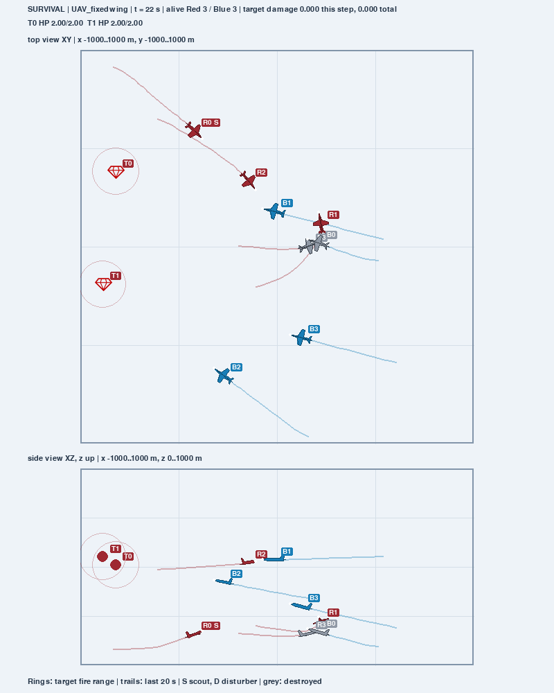
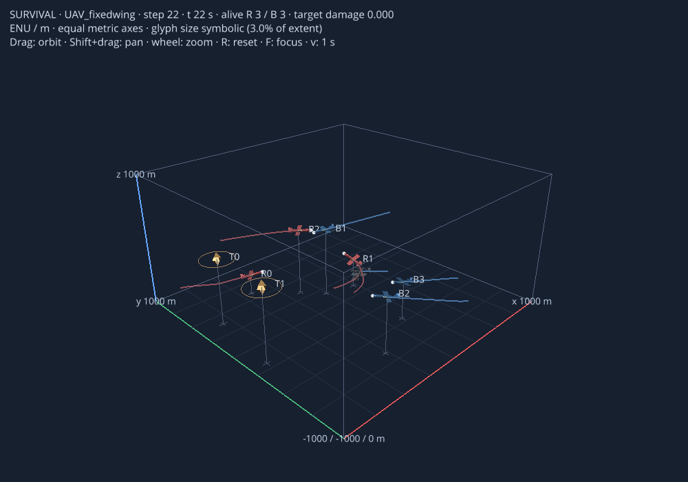

# SkyHAD

SkyHAD is a multi-agent air-defense environment for reinforcement learning. Red UAVs defend stationary assets against Blue attacking UAVs. Three vehicle models share one set of combat, observation and task rules, so the same experiment can move from a fast point-mass model to six-degree-of-freedom aircraft by changing one argument.

| Model | Dynamics | Parameters from |
| --- | --- | --- |
| `particle` | 3D (or planar) point mass, 1 s steps | project defaults |
| `UAV_fixedwing` | 6-DOF rigid body, nonlinear Aerosonde aerodynamics and propeller | [Beard & McLain, BYU MAGICC](https://github.com/byu-magicc/mavsim_public) |
| `UAV_quadrotor` | 6-DOF rigid body, geometric attitude control | [Lee, Leok & McClamroch 2010](https://arxiv.org/abs/1003.2005) |

<p align="center">
  
  
</p>

The environment follows the [PettingZoo](https://pettingzoo.farama.org/) Parallel API. No learning algorithm is included.

## Installation

Python 3.10–3.12.

```bash
git clone https://github.com/Sailero/SkyHAD.git
cd SkyHAD
pip install -e .                      # headless: NumPy, SciPy, Gymnasium, PettingZoo
pip install -e ".[render]"            # + 2D window / RGB frames (Pygame)
pip install -e ".[render,viewer3d,record]"   # + 3D view (PySide6, VisPy) and MP4 recording
```

On Linux the 3D view needs an OpenGL display and Qt's XCB runtime libraries:

```bash
sudo apt-get install -y libegl1 libxcb-cursor0 libxkbcommon-x11-0 libxcb-icccm4 libxcb-keysyms1 libxcb-shape0 libxcb-glx0
```

## Quick start

```python
from had_env import make_env

env = make_env(env_agent_type="UAV_fixedwing", red_count=4, blue_count=4,
               max_cycles=100, render_mode="human")
observations, infos = env.reset(seed=42)
while env.agents:
    actions = {agent: env.action_space(agent).sample() for agent in env.agents}
    observations, rewards, terminations, truncations, infos = env.step(actions)
env.close()
```

Agents are named `red_0 … red_{n-1}` and `blue_0 … blue_{m-1}`. Both teams act simultaneously from the same pre-step observations; each step is 1 s of simulated time. Runnable scripts are in [`examples/`](examples).

## Environment at a glance

**Scenario.** Assets sit in a region near the west side of the world. Red spawns around the assets, Blue on the east half. Attackers fire automatically: a Blue attacker fires when an asset is within its fire range, a Red attacker when a Blue attacker is. A firing attacker self-destructs and damages every enemy within its blast radius (full damage inside 300 m, falling linearly to zero at 600 m in 3D, scaled by model). Optional Scout and Disturb roles add a sensing sector and a jamming sector that slowly damages aircraft of both teams. Aircraft also die on collision.

| Setting | Options (default first) |
| --- | --- |
| `env_agent_type` | `particle`, `UAV_fixedwing`, `UAV_quadrotor` |
| `env_agent_action_type` | `acceleration`, `position`, `actuator` (UAVs only) |
| `task_mode` | `survival`, `damage` |
| `api` | `parallel`, `mpe`, `grouping` |
| `spatial_dim` | `3`; `2` for planar particles |
| team sizes | `red_count=4`, `blue_count=4`, `target_count=2`, plus `red_scouts`, `red_disturbers`, `blue_scouts`, `blue_disturbers` |

**Actions.**

| Control | Space | Meaning |
| --- | --- | --- |
| `acceleration` (discrete) | `Discrete(27)` (`Discrete(9)` in 2D) | zero or one of 26 unit directions |
| `acceleration`, `continuous=True` | `Box(-1, 1, (3,))` | scaled by the model's acceleration limit and tracked by its controller |
| `position` | `Box(world_low, world_high, (3,))` | fly toward an absolute point (fixed wings fly through it) |
| `actuator`, fixed wing | `Box(-1, 1, (4,))` | elevator, aileron, rudder (±25°), throttle |
| `actuator`, quadrotor | `Box(0, 1, (4,))` | front, right, rear, left rotor thrust fractions |

**Observations.** Each agent sees one 11-value row for every other entity in a fixed order: relative position and velocity (normalized), health, alive flag and red/blue/target flags. Dead entities are zero rows. UAV agents (and particles under position control) additionally receive their own raw state as a `Dict` observation. `env.state()` gives a centralized critic vector, and `infos[agent]` carries masks, events, time and task counters.

**Rewards and endings.**

| | `survival` | `damage` |
| --- | --- | --- |
| Red reward | +10 when every Blue attacker is destroyed, −10 when an asset is destroyed | minus the asset damage dealt this step |
| Natural ending | either of those events | every Blue attacker destroyed |

Every teammate receives the same team reward, so count it once per team. `max_cycles` truncates sampling and never awards a win. See the [API reference](docs/API.md) for exact shapes, masks and info keys.

## Rendering and video

Rendering never changes physics, observations or random streams.

```python
env = make_env(env_agent_type="UAV_quadrotor", render_mode="rgb_array")
env.set_view_mode("3d")       # default "projections": XY top and XZ side views
env.reset(seed=0)
frame = env.render()          # H x W x 3 uint8
```

The 2D view draws equal-scale top and side projections with short trails, target fire-range rings and attitude-accurate aircraft outlines. The 3D view (UAV models) adds orbit/pan/zoom, a ground grid and altitude drop lines. To save a video:

```python
from had_env.render.video import VideoRecorder

with VideoRecorder(env, "outputs/episode.mp4", fps=10) as video:
    video.capture()
    while env.agents:
        env.step({a: env.action_space(a).sample() for a in env.agents})
        video.capture()
```

## Customizing

- **Per experiment:** pass keywords or a JSON/dict `config` to `make_env` (world bounds, target region, spawn regions, fire range, scene scale, target health, roles, horizon). Explicit keywords override the config; `env.effective_config` shows the resolved values.
- **Rules and constants:** [`had_env/config.py`](had_env/config.py) collects every tunable constant with units: particle limits, attack radii, disturber and scout sectors, rewards and model presets.
- **New behavior:** each concern lives in one small module (layout below). A new vehicle model only needs a `RigidBodyDynamics` subclass that returns body forces and moments.

```text
had_env/
  factory.py, environment.py, mpe.py   make_env, PettingZoo Parallel env, MPE-style lists
  config.py                            constants and immutable EnvConfig
  simulation.py, world.py              episode lifecycle, collisions and automatic fire
  initialization.py                    reset distributions
  observations.py, tasks.py            observation packing, rewards and endings
  agents/                              Attack, Scout and Disturb roles
  dynamics/                            batched RK4 rigid body, fixed wing, quadrotor
  grouping/                            optional event-driven target-assignment API
  render/                              optional 2D (Pygame), 3D (VisPy) and video
```

## Performance

Measured for 4 vs 4 on one desktop CPU core: particle ≈ 700 steps/s; fixed wing ≈ 12 and quadrotor ≈ 16 steps/s. Each UAV step integrates 1 s with 100 RK4 substeps for all aircraft at once. Use several environment processes for large-scale training.

## Documentation

- [API reference](docs/API.md): constructor options, spaces, info keys, masks, grouping API
- [Modeling notes](docs/MODELING.md): equations, parameters, assumptions and their sources
- [Benchmark protocol](docs/BENCHMARK.md) and [`examples/defender_evaluation.py`](examples/defender_evaluation.py)
- [Mathematical formulation (PDF)](docs/PROBLEM_FORMULATION.pdf) with its [LaTeX source](docs/PROBLEM_FORMULATION.tex)
- [Changelog](CHANGELOG.md)

## Tests

```bash
pip install -e ".[render,viewer3d,record,test]"
pytest -q
```

Tests that need an optional package or an OpenGL context skip when it is unavailable.

## License

[MIT](LICENSE)
